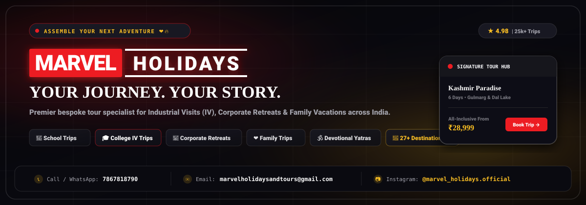
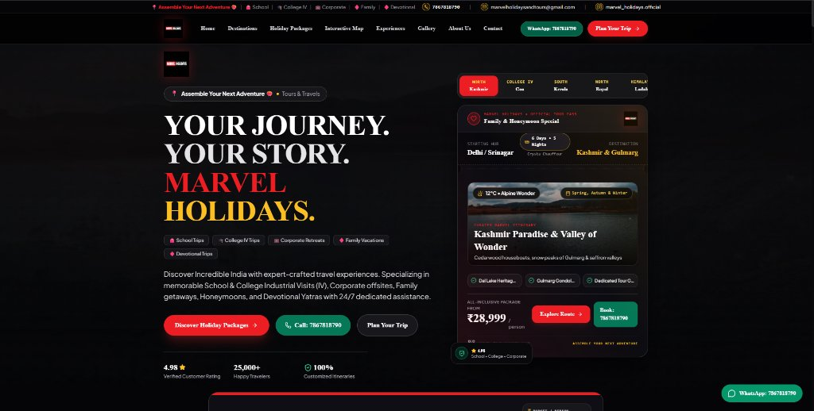
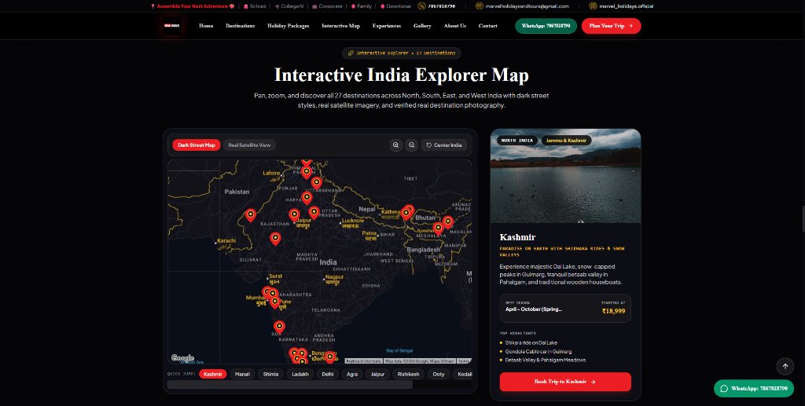
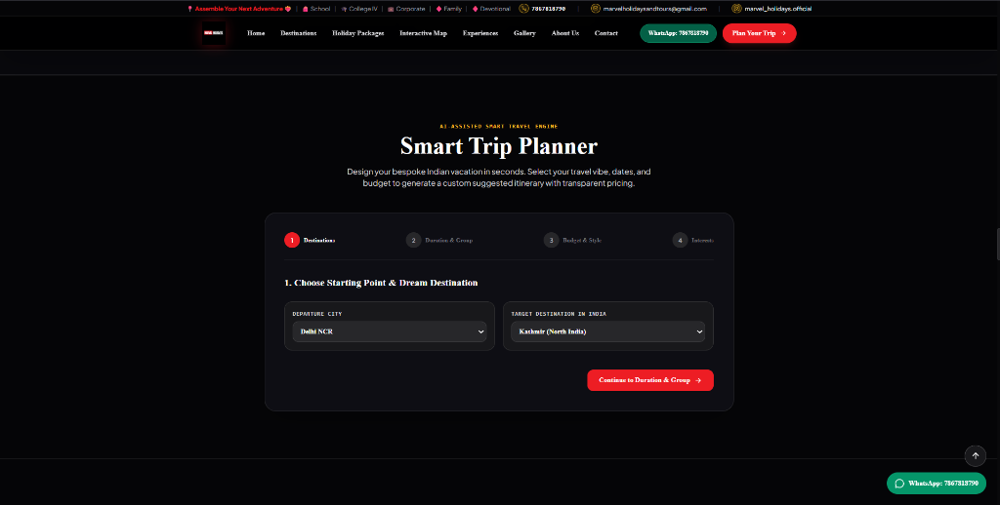
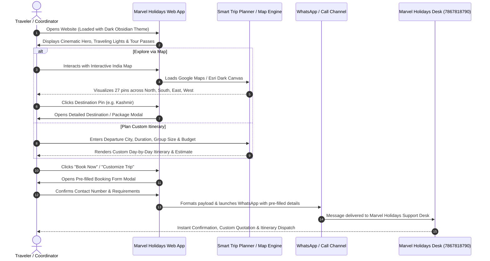

<div align="center">

# 🌟 MARVEL HOLIDAYS
### *Assemble Your Next Adventure ❤️‍🔥*

[](https://jagan96404.github.io/Marvel-Holidays/)
[](https://reactjs.org/)
[](https://www.typescriptlang.org/)
[](https://tailwindcss.com/)
[](https://vitejs.dev/)

<br />

<!-- SVG Banner -->
<p align="center">
  
</p>

**Premier Tours & Travels specialist for School Trips, College Industrial Visits (IV), Corporate Offsites & Retreats, Family Vacations, and Devotional Yatras across Incredible India.**

---

### 📞 Instant Contact & Official Channels
| 📞 Call / WhatsApp | ✉️ Official Email | 📷 Instagram |
| :---: | :---: | :---: |
| [**+91 7867818790**](https://wa.me/917867818790) | [**marvelholidaysandtours@gmail.com**](mailto:marvelholidaysandtours@gmail.com) | [**@marvel_holidays.official**](https://www.instagram.com/marvel_holidays.official/) |

</div>

---

## 📖 Table of Contents
1. [Project Overview](#-project-overview)
2. [Visual Output & Live Screenshots](#-visual-output--live-screenshots)
3. [Core Capabilities & Features](#-core-capabilities--features)
4. [System Architecture](#-system-architecture)
5. [User Workflow & Sequence Flow](#-user-workflow--sequence-flow)
6. [Technology Stack](#-technology-stack)
7. [Directory Structure](#-directory-structure)
8. [Installation & Local Setup](#-installation--local-setup)
9. [Deployment Guide](#-deployment-guide)

---

## 📌 Project Overview

**MARVEL HOLIDAYS** is a high-performance, modern, black luxury travel booking and exploration web platform designed for discerning travelers, educational institutions, and corporate groups.

Built with **React 18**, **TypeScript**, **Tailwind CSS**, and **Vite**, the application combines obsidian dark aesthetics with an interactive hybrid mapping engine (Google Maps JS API + Leaflet fallback), an AI-assisted 4-step smart trip planner, 3D perspective tour boarding passes, and instant booking dispatch via WhatsApp and direct call channels.

### Specialized Travel Segments
- 🎒 **School Trips**: Educational expeditions with certified guide escorts, safety protocols, and curated learning landmarks.
- 🎓 **College Industrial Visits (IV)**: Factory permissions, coastal circuits (e.g. Goa), beachside resort stays, campfire & DJ nights.
- 💼 **Corporate Retreats & Offsites**: Luxury transport, conference villas, team-building excursions, and executive transport.
- 👨‍👩‍👧‍👦 **Family Vacations & Honeymoons**: Cedarwood houseboats in Kashmir, tea estates in Munnar, royal palaces in Rajasthan.
- 🕉️ **Devotional Yatras**: Spiritual pilgrimage tours (Rishikesh, Haridwar, Kanyakumari, Varanasi) with comfortable pacing.

---

## 📸 Visual Output & Live Screenshots

### 1. Hero Section & Curated Signature Tour Pass
Features a cinematic ambient traveling video background, glowing traveling light rays, official Marvel branding, and a 3D interactive tour boarding pass with real-time mouse perspective tilting.
<p align="center">
  
</p>

---

### 2. Interactive India Explorer Map
Pan, zoom, and explore 27+ destinations with Google Maps dark luxury street styles, real satellite imagery, custom pins, and instant detail modal launch.
<p align="center">
  
</p>

---

### 3. AI-Assisted Smart Trip Planner
A 4-step wizard that automatically constructs a bespoke daily itinerary with itemized cost calculation based on group size, departure city, destination, and budget tier.
<p align="center">
  
</p>

---

## 🚀 Core Capabilities & Features

### 1. Hybrid Resilient Mapping Engine
- **Primary Engine**: Google Maps JavaScript API with customized dark luxury styling (`#181824` roads, `#d4af37` gold administrative borders, `#09090b` water bodies).
- **Graceful Fallback**: Automatically listens to `window.gm_authFailure` and network latency to switch seamlessly to **Leaflet** with **Esri Dark Gray Canvas** and **Esri World Satellite** tiles (100% free, zero watermarks, zero crashes).
- **Interactive Markers**: 27 custom pins across North, South, East, and West India with quick jump pills and card previews.

### 2. 3D Perspective Tour Pass & Fleet Hub
- Replaced conventional static lists with a **3D interactive boarding pass** responding to mouse position.
- Highlights authentic road & rail transport allocations:
  - 🚍 *Luxury AC Multi-Axle Volvo Coach* (Colleges & Schools)
  - 🚘 *Private AC Innova Crysta Chauffeur* (Families & Honeymoons)
  - 🚐 *Luxury AC Force Urbania / Tempo Traveller* (Corporate Groups)
  - 🚙 *4x4 Luxury Tourist Expeditions* (Himalayan High Passes)

### 3. Comprehensive Destination & Package Showcases
- **27 Verified Destinations**: High-resolution imagery, optimal visiting season, weather cues, and starting prices in ₹ INR.
- **8 Curated Package Collections**: Day-wise itineraries, vehicle allocations, inclusions (hotels, meals, permits), and exclusions.
- **Package & Destination Modals**: Interactive overlays for full breakdown without page reloads.

### 4. Smart Trip Planner (4 Steps)
1. **Starting Point & Target**: Select from top departure cities and all 27 destinations.
2. **Duration & Group Type**: Solo, Couple, Family, College Group, Corporate Team.
3. **Budget & Accommodation**: Backpacker / Student, Comfort Plus, Luxury Boutique.
4. **Interests**: Adventure, Heritage, Nature, Relaxation, Food & Culture.
- Generates a bespoke day-by-day plan with transparent instant quote and WhatsApp pre-fill.

### 5. Multi-Channel Instant Booking
- Custom booking form integrated directly with:
  - 📲 **WhatsApp Direct API**: Pre-populates traveler name, destination, departure city, dates, and group size into WhatsApp message.
  - 📞 **Direct Dial Phone Assistance**: Tap to call `7867818790`.
  - 📧 **Direct Email**: One-click compose to `marvelholidaysandtours@gmail.com`.

---

## 🏗️ System Architecture

The application is structured into a modular, component-driven React architecture with strict separation of concerns between data catalogs, state orchestration, UI presentation, and mapping adapters.

```mermaid
graph TD
    subgraph UI Presentation Layer
        App[App.tsx - Root Orchestrator]
        Loading[LoadingScreen.tsx]
        Navbar[Navbar.tsx - Contact Bar & Branding]
        Hero[HeroSection.tsx - Video Ambiance & Traveling Lights]
        TourHub[LuxuryTravelHub.tsx - 3D Perspective Tour Pass]
        Search[FloatingSearch.tsx]
        Destinations[DestinationsSection.tsx & DestinationModal.tsx]
        Packages[PackagesSection.tsx & PackageModal.tsx]
        Planner[SmartTripPlanner.tsx - 4-Step Engine]
        Map[InteractiveMap.tsx - Hybrid Map Engine]
        Gallery[GallerySection.tsx]
        Contact[ContactBookingSection.tsx & BookingConfirmationModal.tsx]
        Footer[Footer.tsx]
    end

    subgraph Data & Assets Layer
        DataDest[data/destinations.ts - 27 Destinations]
        DataPkg[data/packages.ts - 8 Handcrafted Packages]
        DataExp[data/experiences.ts - 6 Travel Styles]
        BrandLogo[MarvelLogo.tsx - Cropped Wide Vector/PNG]
        Media[public/images/destinations - Real Travel Photos]
    end

    subgraph External Services & Engines
        GMaps[Google Maps JavaScript API]
        Leaflet[Leaflet.js + Esri Dark Canvas Engine]
        WhatsApp[WhatsApp Direct Click-to-Chat API]
    end

    App --> Navbar
    App --> Hero
    Hero --> TourHub
    Hero --> BrandLogo
    App --> Destinations
    App --> Packages
    App --> Planner
    App --> Map
    App --> Contact
    App --> Footer

    Destinations --> DataDest
    Packages --> DataPkg
    Map --> DataDest
    Map --> GMaps
    Map -.->|Fallback on Auth/Timeout| Leaflet
    Contact --> WhatsApp
```



---

## 🔄 User Workflow & Sequence Flow

The following diagram illustrates how users navigate from discovering destinations to generating custom itineraries and dispatching their booking:



---

## 💻 Technology Stack

| Layer | Technology | Purpose |
| :--- | :--- | :--- |
| **Framework** | React 18.3 | High-performance component architecture |
| **Language** | TypeScript 5.5 | Type-safe data models, interfaces, and props |
| **Build Tool** | Vite 5.4 | Ultra-fast HMR and optimized production bundles |
| **Styling** | Tailwind CSS 3.4 | Utility-first obsidian black palette & responsive layouts |
| **Icons** | Lucide React | Modern, consistent vector icons |
| **Mapping Engine** | Google Maps JS API + Leaflet | Dual-engine fallback for zero downtime and no watermarks |
| **Typography** | Times New Roman + Plus Jakarta Sans + Outfit | Elegant serif titles with legible modern geometric UI text |
| **Deployment** | GitHub Pages (`gh-pages`) | Global edge CDN hosting with SPA 404 routing fallback |

---

## 📁 Directory Structure

```text
Marvel Holidays/
├── docs/
│   ├── banner.svg                    # Official high-resolution SVG project banner
│   └── screenshots/
│       ├── hero-section.jpg          # Live screenshot: Hero section & Tour Pass
│       ├── interactive-map.jpg       # Live screenshot: Interactive India map
│       └── smart-trip-planner.png    # Live screenshot: 4-step smart planner
├── public/
│   ├── banner.svg                    # Public banner asset
│   ├── marvel-logo.png               # Cropped wide official Marvel Holidays logo
│   └── images/
│       └── destinations/             # Real photography for all 27 Indian destinations
├── src/
│   ├── components/
│   │   ├── AboutSection.tsx          # Brand story, credentials & values
│   │   ├── BookingConfirmationModal  # Success modal after booking trigger
│   │   ├── ContactBookingSection.tsx # Contact form, phone, WhatsApp & email links
│   │   ├── DestinationModal.tsx      # Deep-dive destination overview overlay
│   │   ├── DestinationsSection.tsx   # Filterable 27-destination gallery
│   │   ├── ExperiencesSection.tsx    # 6 Curated travel styles
│   │   ├── FloatingSearch.tsx        # Quick filter bar
│   │   ├── Footer.tsx                # Brand footer with quick navigation & social links
│   │   ├── GallerySection.tsx        # High-res photography grid
│   │   ├── HeroSection.tsx           # Ambient video, traveling lights, headline
│   │   ├── InteractiveMap.tsx        # Google Maps + Leaflet hybrid map engine
│   │   ├── LoadingScreen.tsx         # Brand progress loader
│   │   ├── LuxuryTravelHub.tsx       # 3D interactive signature tour boarding pass
│   │   ├── MarvelLogo.tsx            # Multi-size official Marvel Holidays logo
│   │   ├── Navbar.tsx                # Sticky top contact bar & main navigation
│   │   ├── PackageModal.tsx          # Day-by-day itinerary modal
│   │   ├── PackagesSection.tsx       # 8 Primary holiday package categories
│   │   ├── SmartTripPlanner.tsx      # 4-Step custom itinerary builder
│   │   ├── TestimonialsSection.tsx   # Verified customer reviews
│   │   └── WhyChooseUs.tsx           # Value propositions & guarantees
│   ├── data/
│   │   ├── destinations.ts           # Complete data for all 27 destinations
│   │   ├── experiences.ts            # Experience categories data
│   │   └── packages.ts               # Detailed day-wise package itineraries
│   ├── types/
│   │   └── index.ts                  # Shared TypeScript interfaces & types
│   ├── App.tsx                       # Main application state and layout
│   ├── index.css                     # Dark luxury obsidian theme & animations
│   └── main.tsx                      # Vite React entry point
├── dist/                             # Compiled production build (tracked on gh-pages)
├── index.html                        # HTML entry point with cache-busting headers
├── package.json                      # Project dependencies & scripts
├── tailwind.config.js                # Custom colors, fonts, and keyframes
├── tsconfig.json                     # TypeScript compiler configuration
└── vite.config.ts                    # Vite build configuration (base path for GitHub Pages)
```

---

## 🛠️ Installation & Local Setup

### Prerequisites
- [Node.js](https://nodejs.org/) (v18.0.0 or higher recommended)
- `npm` or `pnpm`

### 1. Clone the Repository
```bash
git clone https://github.com/Jagan96404/Marvel-Holidays.git
cd Marvel-Holidays
```

### 2. Install Dependencies
```bash
npm install
```

### 3. Start Development Server
```bash
npm run dev
```
Open [http://localhost:5173/](http://localhost:5173/) in your browser to view the application with hot module replacement (HMR).

### 4. Build for Production
```bash
npm run build
```
The optimized bundle will be generated in the `dist/` directory.

---

## 🌐 Deployment Guide

This project is configured for automated deployment to **GitHub Pages**.

1. **Base Path Configuration**: Configured in `vite.config.ts`:
   ```ts
   export default defineConfig({
     base: './',
     plugins: [react()],
   });
   ```
2. **Build and Export**:
   ```bash
   npm run build
   cp dist/index.html dist/404.html
   ```
3. **Push to `gh-pages` Branch**:
   ```bash
   cd dist
   git add -A
   git commit -m "Deploy latest production build"
   git push origin gh-pages
   ```

---

## 🛡️ License & Credits

- **Brand & Content**: © 2026 **MARVEL HOLIDAYS**. All rights reserved.
- **Headquarters & Booking**: Call/WhatsApp: `+91 7867818790` | Email: `marvelholidaysandtours@gmail.com`
- **Official Instagram**: [@marvel_holidays.official](https://www.instagram.com/marvel_holidays.official/)

<div align="center">
  <sub>Designed &amp; Developed with ❤️‍🔥 for MARVEL HOLIDAYS</sub>
</div>
